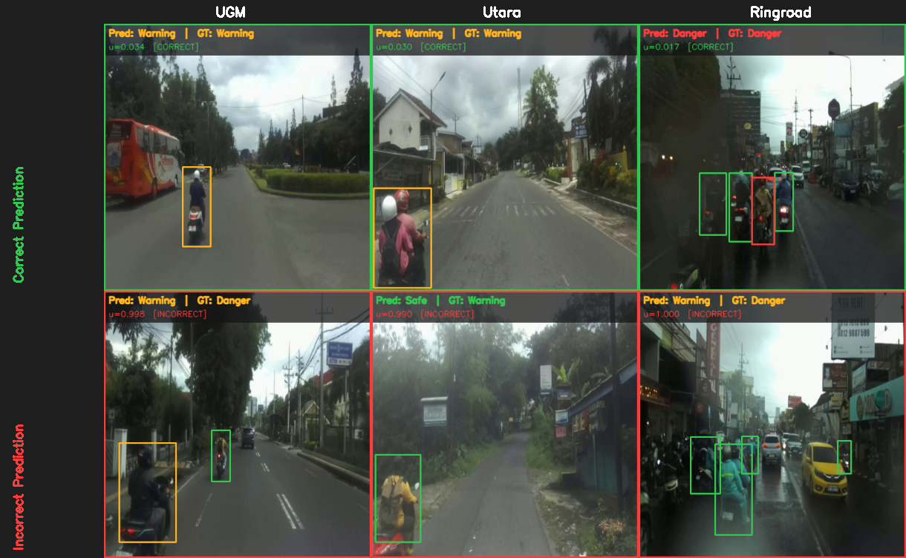

# DASTRP-Net

**Domain-Adaptive Spatio-Temporal Risk Perception Network for Motorcycle Behavior Recognition**

[]()
[]()
[](LICENSE)
[](https://github.com/SaveVic/dastrp-dataset)

Official source code for the paper:

> **DASTRP-Net: Domain-Adaptive Spatio-Temporal Risk Perception Network for Motorcycle Behavior Recognition**

This repository contains the model, training and evaluation code for all
experiments reported in the paper (main model, ablation study A1–A6,
baselines B1–B3), preprocessing and clip-extraction tools, pre-trained
weights, an inference demo notebook, and the scripts used to generate every
result table and figure. The dataset (IMBD-ESR) is hosted separately at
**<https://github.com/SaveVic/dastrp-dataset>**.



---

## Quick start (pre-trained model)

```bash
git clone https://github.com/SaveVic/dastrp-model.git && cd dastrp-model
pip install torch torchvision && pip install -r requirements.txt   # see docs/INSTALL.md
python tools/download_weights.py                                     # weights from GitHub Releases
# put an IMBD-ESR video in data/imbd-esr/videos/..., then
python scripts/inference.py --checkpoint weights/dastrp_exp3.pth --yolo weights/yolo11n_motor.pt \
       --input data/imbd-esr/videos/ugm/ugm_1_1.mp4 --output runs/demo/ugm_1_1_annotated.mp4
```

or open **`notebooks/demo_inference.ipynb`**.

---

## Overview

DASTRP-Net classifies the risk level of motorcycle behavior
(**Safe / Warning / Danger**) from short ego-vehicle dashcam clips
in heterogeneous Southeast-Asian traffic, and outputs a calibrated
uncertainty for each prediction. For each clip of *T* = 4 frames:

| # | Component | Implementation (`models/architecture.py`) |
|---|---|---|
| 1 | Frozen detector/backbone | `YOLODetector` — YOLO11n, P4 feature map + motorcycle boxes |
| 2 | Domain-conditional normalization | `SceneClassifier` + `ConditionalBN` (UGM / Utara / Ringroad) |
| 3 | Object features & motion | `RoIExtractor`, `VelocityTracker` |
| 4 | Interaction graph | `MotionGraphBuilder` + `SpatioTemporalGNN` (GATv2-style, 2 layers, 4 heads) |
| 5 | Scene–interaction fusion | `CrossModalFusion` (multi-head cross-attention) |
| 6 | Clip-level risk + uncertainty | `EvidentialRiskHead` (Dirichlet / EDL) |
| 7 | Auxiliary heads | `MotionLabelHead` (moving/stationary), `ObjectRiskHead` (per-motorcycle risk) |

The full model is `DASTRPNet`. Ablation variants are selected with a single
constructor argument (`ablation=...`), so every variant shares exactly the
same training code.

---

## Repository structure

```
dastrp-model/
├── models/
│   ├── architecture.py          # DASTRP-Net, all sub-modules, ablation switches
│   ├── baseline_b1.py           # B1  YOLO11n + MLP (frame-only)
│   ├── baseline_b2.py           # B2  YOLO11n + BiLSTM
│   ├── baseline_b3.py           # B3  YOLO11n + Transformer encoder
│   ├── baseline_b4.py           # additional: Scene-Graph GCN + LSTM (Yu et al. 2021)
│   └── baseline_b5.py           # additional: SlowFast (Feichtenhofer et al. 2019)
├── data/
│   ├── dataset.py               # clip-based Dataset / DataLoader
│   └── README.md                # data folder layout + preprocessing rules
├── scripts/                     # stand-alone entry points
│   ├── train.py                 # train DASTRP-Net (+ --ablation)
│   ├── train_baseline.py        # train baselines B1–B5
│   ├── evaluate.py              # evaluate a training run or released weights
│   ├── evaluate_ablation_batch.py
│   ├── inference.py             # run a model on a video
│   ├── extract_*.py             # result tables (ablation, baselines, history)
│   ├── plot_*.py                # paper figures
│   └── generate_qualitative_figure.py, compose_qualitative_grid.py
├── tools/
│   ├── convert_imbd_esr.py      # IMBD-ESR release -> frames + labels (preprocessing)
│   ├── extract_clips.py         # list / render the T-frame clips
│   ├── split_videos.py          # stratified train/val/test split
│   ├── prepare_dataset.py       # internal pipeline from raw CVAT exports
│   ├── download_weights.py      # fetch + verify pre-trained weights
│   ├── export_checkpoint.py     # clean training checkpoints for release
│   ├── check_env.py             # verify the installation
│   └── check_release.py         # scan for private data before publishing
├── utils/reproducibility.py     # set_seed(), --seed / --deterministic
├── notebooks/demo_inference.ipynb
├── weights/                     # manifest.json + README (files via Releases)
├── docs/INSTALL.md, docs/figures/
├── environment.yml, requirements.txt
├── Makefile                     # end-to-end reproduction
├── CITATION.cff, LICENSE
└── .github/workflows/checks.yml # CI: privacy scan + byte-compile
```

All scripts are run from the repository root and print their options
with `-h`.

---

## Installation

```bash
python -m venv .venv && source .venv/bin/activate
pip install torch torchvision --index-url https://download.pytorch.org/whl/cu124   # or /cpu
pip install -r requirements.txt
python tools/check_env.py --forward          # should end with "Environment OK"
```

Conda (`environment.yml`), CPU-only setup, version requirements and
troubleshooting are in **[docs/INSTALL.md](docs/INSTALL.md)**.

---

## Data

1. Download IMBD-ESR from <https://github.com/SaveVic/dastrp-dataset> into
   `data/imbd-esr/` (`annotations/` + `videos/`).
2. Preprocess: extract frames and convert annotations.

```bash
python tools/convert_imbd_esr.py --src data/imbd-esr --dst data/processed/dastrp
python tools/convert_imbd_esr.py --src data/imbd-esr --dst data/processed/yolo --mode yolo
```

3. Optionally, list or render the T-frame clips used for training and evaluation:

```bash
python tools/extract_clips.py --dataset data/processed/dastrp --out data/clips
python tools/extract_clips.py --dataset data/processed/dastrp --out data/clips \
       --splits test --export jpg --label danger --limit 50
```

The full folder layout and every preprocessing rule (frame selection,
clip construction, clip label, augmentation) are documented in
**[data/README.md](data/README.md)**.

> IMBD-ESR v0.1.0 is a sample release (3 one-minute videos, all in `test`):
> enough for evaluation, inference and the notebook. Training needs the
> full release (v1.0.0, 24 videos).

---

## Pre-trained weights

| File | Model |
|---|---|
| `yolo11n_motor.pt` | YOLO11n motorcycle detector (frozen backbone of DASTRP-Net) |
| `dastrp_exp3.pth` + `dastrp_exp3_config.json` | DASTRP-Net, Exp3 (main result) |

```bash
python tools/download_weights.py          # downloads and checks SHA-256 against weights/manifest.json

python scripts/evaluate.py \
    --config     weights/dastrp_exp3_config.json \
    --checkpoint weights/dastrp_exp3.pth \
    --yolo       weights/yolo11n_motor.pt \
    --dataset    data/processed/dastrp \
    --split test --out-dir runs/eval_release
```

Details: **[weights/README.md](weights/README.md)**.

---

## Reproducing the paper

Every step is also a `make` target; `make all DATA_SRC=/path/to/imbd-esr`
runs the whole pipeline. All training and evaluation scripts accept
`--seed` (default 42) and `--deterministic` (see *Reproducibility*).

### 1. Train the detector

```bash
yolo detect train data=data/processed/yolo/dataset.yaml model=yolo11n.pt \
     imgsz=640 epochs=100 seed=42 project=runs/yolo name=v11n
# make yolo        (make yolo_all: v8n / v8s / 11n / 11s)
```

### 2. Train DASTRP-Net (Exp3)

```bash
python scripts/train.py \
    --dataset  data/processed/dastrp \
    --yolo     runs/yolo/v11n/weights/best.pt \
    --epochs 100 --patience 20 --batch 16 --T 4 --stride 2 --seed 42 \
    --save-dir runs/exp3
```

`train.py` writes `config.json`, `best_model.pth`, `history.json` and
TensorBoard logs to `--save-dir` and evaluates the best checkpoint on the
test split at the end.

### 3. Ablation study (A1–A6)

```bash
python scripts/train.py --dataset ... --yolo ... \
    --ablation no_gnn --epochs 50 --patience 15 --save-dir runs/ablation/no_gnn
# or: make ablation
```

| ID | `--ablation` | Change |
|---|---|---|
| A1 | `no_gnn` | graph embedding replaced by a zero vector |
| A2 | `no_cbn` | Conditional BN → standard BatchNorm |
| A3 | `no_fusion` | cross-modal attention → concat + linear projection |
| A4 | `no_edl` | evidential head → softmax classifier with cross-entropy |
| A5 | `no_velocity` | velocity vectors set to zero |
| A6 | `no_obj_risk` | Object Risk Head and its loss removed |

### 4. Baselines (B1–B3)

```bash
python scripts/train_baseline.py --model b1 --dataset ... --yolo ... \
    --epochs 50 --patience 15 --save-dir runs/baseline/b1
# or: make baselines
```

| ID | `--model` | Method |
|---|---|---|
| B1 | `b1` | YOLO11n + MLP (frame-only) |
| B2 | `b2` | YOLO11n + BiLSTM |
| B3 | `b3` | YOLO11n + Transformer encoder |
| – | `b4` | Scene-Graph GCN + LSTM (Yu et al., T-ITS 2021); additional, not in the final paper |
| – | `b5` | SlowFast (Feichtenhofer et al., ICCV 2019); additional, not in the final paper |

All baselines share the backbone, split, class weighting, optimizer and
schedule of DASTRP-Net.

### 5. Evaluation

```bash
python scripts/evaluate.py --config runs/exp3/config.json --split test --seed 42
python scripts/evaluate_ablation_batch.py --results-dir runs --skip-existing
```

Each run directory gets `result_test.json` (accuracy, per-class and macro
F1, per-domain accuracy, object-level F1, uncertainty) and
`result_test_per_video.json`.

### 6. Tables and figures

| Paper item | Script |
|---|---|
| Detector comparison (YOLOv8n/s, YOLO11n/s) | `plot_yolo_curves.py` |
| Main results, confusion matrices, training curves | `plot_result_figures.py` |
| Uncertainty analysis | `plot_uncertainty_figure.py` |
| Ablation table | `extract_ablation_results.py`, `extract_ablation_data.py` |
| Baseline comparison table | `extract_sota_data.py` |
| Qualitative figure | `generate_qualitative_figure.py`, `compose_qualitative_grid.py` |

```bash
make report figures
```

### About Exp1 / Exp2

The paper reports three configurations. **Exp3** (the final model) is what
this repository trains by default. **Exp2** uses the same code with the
earlier, non-stratified video split, so it is reproduced by running
`train.py` on a dataset converted with that split
(`convert_imbd_esr.py --split-file <old_split>.json`).
**Exp1** is the earlier baseline trained with plain cross-entropy and no
class weighting, from a previous version of the code, and is not
reproduced by this repository.

---

## Reproducibility

* `--seed N` (default 42) seeds Python, NumPy and PyTorch (CPU + CUDA)
  through `utils/reproducibility.py`. DataLoaders use an independent
  generator per split (train = N, val = N+1, test = N+2) and seeded workers.
* `--deterministic` additionally enables deterministic cuDNN/PyTorch
  kernels, which gives bit-identical runs on the same hardware and software
  at some cost in speed. Without it, `cudnn.benchmark` is on (the setting of
  the original runs), so repeated GPU runs can differ slightly.
* Frame selection (`convert_imbd_esr.py --seed`) and clip rendering
  (`extract_clips.py --seed`) are seeded too.
* Each run stores its full configuration, seed included, in `config.json`.

---

## Demo notebook

`notebooks/demo_inference.ipynb` loads the released weights (downloading
them if missing), runs DASTRP-Net on an IMBD-ESR video, and shows:
- per-clip predictions with the Dirichlet parameters and uncertainty,
- the risk and uncertainty timeline,
- the most risky frame with per-motorcycle motion and risk,
- the annotated output video.

```bash
pip install jupyterlab
jupyter lab notebooks/demo_inference.ipynb
```

---

## Inference on a video

```bash
python scripts/inference.py \
    --checkpoint weights/dastrp_exp3.pth \
    --yolo       weights/yolo11n_motor.pt \
    --input      path/to/ugm_1_1.mp4 \
    --output     runs/demo/ugm_1_1_annotated.mp4 \
    --log-csv    runs/demo/ugm_1_1_log.csv
```

The road domain is inferred from the file name (`ugm_*`, `utara_*`,
`ringroad_*`); override it with `--domain {0,1,2}`. The CSV log holds
per-frame risk, class probabilities, Dirichlet parameters and uncertainty.

---

## Main hyperparameters

| Setting | Value |
|---|---|
| Clip length *T* / stride (train) / stride (val, test) | 4 / 2 / 4 |
| Input size, batch size | 640, 16 clips |
| Embedding dims *d<sub>f</sub>* / *d<sub>g</sub>* / *d<sub>fuse</sub>* | 256 / 128 / 256 |
| Graph encoder | 2 layers, 4 heads, proximity threshold τ = 0.3 |
| Optimizer | AdamW, lr 1e-4, weight decay 1e-4, grad-clip 5.0 |
| Schedule | cosine annealing + 2-epoch linear warm-up |
| Epochs / early stopping | 100 / patience 20 (ablations and baselines: 50 / 15) |
| Loss weights λ<sub>frame</sub>, λ<sub>domain</sub>, λ<sub>motion</sub>, λ<sub>obj</sub>, λ<sub>unc</sub> | 1.0, 0.2, 0.2, 0.3, 0.1 (u* = 0.4 for Ringroad) |
| Class weights | inverse frequency of the training clip labels |
| Seed | 42 |

All values are defined in `DEFAULT_CFG` in `scripts/train.py`, and each
run stores its full configuration in `config.json`.

Experiments in the paper were run on a single NVIDIA RTX 5000 Ada
(32 GB) with mixed precision. Use `--no-amp` on CPU and `--no-compile` if
`torch.compile` is not available.

---

## Privacy and release checklist

The repository contains code, documentation, one figure from the paper and
`weights/manifest.json`; no dataset files, checkpoints, logs or
machine-specific configuration. Before every push or release:

```bash
python tools/check_release.py --weights weights   # must print "✓ No private data ..."
```

It flags absolute machine paths, e-mail addresses, credentials and tokens,
private IPs, `.env` files, checkpoints/videos/archives or files > 10 MB in
git, notebooks saved with outputs, and image metadata (EXIF/GPS). The same
check runs in CI (`.github/workflows/checks.yml`). Release weights must be
produced with `tools/export_checkpoint.py`, which removes optimizer state
and the training machine's paths from the checkpoints.

---

## Citation

```bibtex
@article{dastrpnet2026,
  title   = {{DASTRP-Net}: Domain-Adaptive Spatio-Temporal Risk Perception
             Network for Motorcycle Behavior Recognition},
  author  = {Aufaclav Zatu Kusuma Frisky, Waffiq Maaroja, Elva Amalia, Humairah, Ihlasul Amal, Andi Dharmawan, Oskar Natan, Jazi Eko Istiyanto, Robert Sablatnig},
  journal = {IEEE Transactions on Intelligent Transportation Systems},
  year    = {2026},
  note    = {Under review}
}

@dataset{imbdesr2026,
  title     = {The {Indonesian} Motorcycle Behavior Dataset for Embedded
               Systems and Robotics ({IMBD-ESR})},
  author  = {Aufaclav Zatu Kusuma Frisky, Waffiq Maaroja, Elva Amalia, Humairah, Ihlasul Amal, Andi Dharmawan, Oskar Natan, Jazi Eko Istiyanto, Robert Sablatnig},
  year      = {2026},
  version   = {0.1.0},
  publisher = {GitHub},
  url       = {https://github.com/SaveVic/dastrp-dataset}
}
```

## License

The code is released under the [MIT License](LICENSE).
The IMBD-ESR dataset is released separately under CC BY 4.0.

## Contact

Email: waffiqmaaroja1998@gmail.com <!-- release-check: allow -->. You can also open an issue in this repository.
